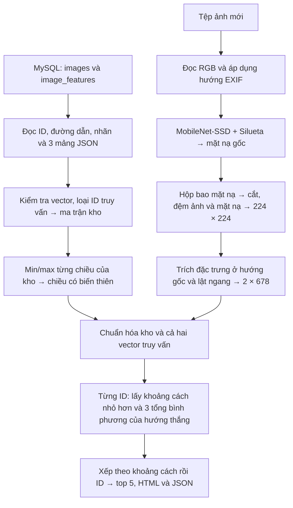

# Hệ CSDL lưu trữ và tìm kiếm ảnh chim

[Chạy demo tìm kiếm và xem kết quả phần 4](#phan-4)

## Tổ chức mã nguồn

| Thư mục / tệp | Chức năng |
|---|---|
| `cli.py` | Điểm chạy chung cho cả hai phần. |
| `indexing/` | Phần 3: tạo mặt nạ (`masking.py`), trích đặc trưng (`features.py`), xử lý bộ ảnh và kiểm tra kết quả (`pipeline.py`). |
| `search/` | Phần 4: chuẩn bị ảnh truy vấn (`query_image.py`), xếp hạng (`retrieval.py`), tìm kiếm dùng chung (`service.py`), CLI (`search_cli.py`) và web demo (`web_app.py`). |
| `sql/` | Kết nối và truy cập MySQL (`database.py`), lược đồ (`schema.sql`) và truy vấn mẫu (`queries.sql`). |
| `tests/` | Kiểm thử đặc trưng, ảnh truy vấn, kho dữ liệu và thứ hạng. |

## Phần 3 · Mặt nạ và đặc trưng ảnh chim

Từ một JPG, chương trình xác định cá thể chim, lưu mặt nạ PNG và ghi ba vector màu sắc, kết cấu, hình dạng vào MySQL. Hai hàm xử lý ảnh trong bộ nhớ dùng chung được cho ảnh truy vấn ở phần 4.

## Chạy trên Windows PowerShell

Mở PowerShell tại thư mục chứa `cli.py`. Lần bàn giao dùng Python 3.14.3 64-bit và MySQL Community Server 8.0.46. Dùng MySQL **từ 8.0.17** để máy chủ thực thi `CHECK (JSON_SCHEMA_VALID(...))` cho từng vector. [Tài liệu MySQL](https://dev.mysql.com/doc/refman/8.0/en/json-validation-functions.html)

```powershell
py -3.14 -m venv .venv
$py = ".\.venv\Scripts\python.exe"
& $py -m pip install -r requirements.txt
& $py cli.py setup-models
if (!(Test-Path .env)) { Copy-Item .env.example .env }
notepad .env
```

Điền thông tin kết nối thật vào `.env` và lưu. Với mật khẩu chứa khoảng trắng hoặc dấu `#`, dùng dấu nháy đơn bao quanh giá trị. Tài khoản cần quyền đọc, thêm và cập nhật trên database đã chọn, cùng quyền tạo bảng ở lần khởi tạo. Nếu database chưa tồn tại, `init-db` sẽ tạo khi tài khoản có quyền. Khi mở cửa sổ PowerShell mới, gán lại `$py` như trên.

```powershell
& $py cli.py inspect
& $py cli.py init-db
# Một JPG → một PNG, một ảnh đối chiếu và một hàng đặc trưng
& $py cli.py run --image data/images/American_Crow_0004_25819.jpg --preview --check-background
& $py cli.py verify-db
# Ba ví dụ gồm nền cát, nền cành cây và nền cỏ
& $py cli.py run --image data/images/California_Gull_0009_40662.jpg --image data/images/Black_And_White_Warbler_0002_160376.jpg --image data/images/American_Pipit_0029_99667.jpg --preview --check-background
# Năm ảnh đầu theo thứ tự tên
& $py cli.py run --limit 5 --preview
# Toàn bộ dataset và kiểm tra lại sau commit từ JPG, PNG và JSON trong MySQL
& $py cli.py run --check-background
& $py cli.py verify-db
& $py -m unittest discover -s tests -v
```

Mỗi lần `run` in đường dẫn đến một thư mục mới trong `runs/`. `results.jsonl` có một dòng cho từng ảnh, gồm đường dẫn, ID, đường dẫn PNG và tổng histogram khi thành công, hoặc công đoạn và lý do khi lỗi. `summary.json` thống kê lần chạy. Một ảnh lỗi cho phép vòng lặp tiếp tục và lệnh trả mã 1 khi kết thúc. Với `--preview`, mỗi ảnh đối chiếu trong `previews/` hiển thị lần lượt JPG gốc, PNG nhị phân và đường viền hồng trên JPG.

```powershell
# Lọc lỗi của lần chạy gần nhất
$run = Get-ChildItem runs -Directory | Where-Object { Test-Path (Join-Path $_.FullName 'summary.json') } | Sort-Object Name -Descending | Select-Object -First 1
Get-Content (Join-Path $run.FullName 'results.jsonl') -Encoding UTF8 | ForEach-Object { $_ | ConvertFrom-Json } | Where-Object error | Select-Object image,stage,error
# Khi chưa có kết nối MySQL, vẫn lưu PNG và cả ba vector trong results.jsonl
& $py cli.py run --offline --limit 3 --preview --check-background
```

## Ảnh đầu vào và mặt nạ

Đã giải mã toàn bộ 1.000 JPG trong `data/images/`. Tất cả là JPEG RGB 224 × 224. Có 70 nhãn, từ 8 đến 25 ảnh mỗi nhãn. Tên file có dạng `<tên_loài>_<4 chữ số>_<mã số>.jpg`. Chỉ tách hai cụm số cuối, rồi thay gạch dưới trong tên bằng khoảng trắng. Ví dụ `Black_And_White_Warbler_0002_160376.jpg` cho nhãn `Black And White Warbler`. Nhãn chỉ dùng để đăng ký ảnh. `inspect` in số lượng cho từng loài.

`masking.py` nạp một bộ MobileNet-SSD và Silueta cho mỗi tiến trình xử lý. Cả hai chạy trên CPU. Lệnh `setup-models` tải ba tệp của hai mô hình vào `models/`, kiểm SHA-256 và dùng lại bản đã khớp. OpenCV 4.x có bộ đọc mạng Caffe cho SSD. ONNX Runtime chạy Silueta. [MobileNet-SSD và danh sách lớp VOC](https://github.com/chuanqi305/MobileNet-SSD/blob/master/demo.py) · [Trọng số và tiền xử lý Silueta](https://github.com/danielgatis/rembg/blob/main/rembg/sessions/silueta.py)

1. SSD đọc toàn ảnh ở 300 × 300. Giữ phát hiện lớp `bird` đạt điểm từ 0,35 và chọn con có điểm cao nhất. Nếu thiếu phát hiện, thử ảnh lật ngang một lần rồi ánh xạ hộp về tọa độ gốc. Không có con đạt ngưỡng ở cả hai lượt sẽ ghi lỗi công đoạn `mask`.
2. Nới hộp SSD thêm 15% chiều rộng và chiều cao ở mỗi bên. Silueta nhận RGB 320 × 320 đã chuẩn hóa, dự đoán vùng tiền cảnh và nội suy điểm số về kích thước vùng cắt. Ngưỡng 0,5 tạo mặt nạ. Trong các vùng liên thông 8 hướng, chọn vùng có nhiều pixel nằm trong hộp SSD nhất.
3. Loại dự đoán rỗng, phủ kín vùng cắt, hoặc không giao hộp. Vùng chọn phải phủ từ 3% đến 96% diện tích hộp, với ít nhất một nửa số pixel của vùng nằm trong hộp. Nếu chưa đạt, chạy lại Silueta với đệm 25%. Nếu cả hai lượt đều lỗi, giữ thông tin đăng ký và ghi lý do. Đây là các ngưỡng lọc hình học. Đánh giá mức bám sát mỏ, chân, đuôi cần xem đường viền chồng.
4. Đưa vùng chim về đúng tọa độ JPG. PNG một kênh có nền 0, chim 255, cùng kích thước với JPG. Bộ xử lý tự tạo thư mục mặt nạ khi cần. Dữ liệu đưa vào mô hình chỉ gồm pixel của ảnh đang xét.

## Ba vector theo phần II của báo cáo

Đầu vào là mảng NumPy RGB `uint8[H,W,3]`. API chấp nhận mặt nạ `bool[H,W]` hoặc `uint8[H,W]` chỉ có 0/255. `extract_features` trả về ba mảng `float64` theo thứ tự trong bảng, tổng cộng 678 giá trị.

| Mục báo cáo | Hàm trong features.py | Công cụ và tham số | Vị trí trong vector, đánh số từ 0 |
|---|---|---|---|
| 2.1.1 · HSV toàn vùng | `color_features` | OpenCV RGB→HSV, NumPy đếm 8 × 4 × 4 bin trên chim | Màu 0–127, 128 chiều |
| 2.1.2 · HSV theo ô | `color_features` | Hộp bao sát mặt nạ, lưới 2 × 2. Theo thứ tự trên trái, trên phải, dưới trái, dưới phải | Màu 128–639, 4 × 128 chiều |
| 2.2.1 · LBP | `texture_features` | scikit-image `uniform`, 8 điểm trên vòng tròn, bán kính 1. Co mặt nạ bằng cửa sổ 3 × 3 để lấy tâm hợp lệ | Kết cấu 0–9, 10 chiều |
| 2.2.2 · GLCM | `texture_features`, `_glcm` | NumPy đếm các cặp có cả hai đầu thuộc chim, 16 mức xám và bốn hướng | Kết cấu 10–25, 4 × 4 chiều |
| 2.3.1 · Hình học | `shape_features` | OpenCV, NumPy, scikit-image. Rộng/cao, extent, solidity, eccentricity, circularity | Hình dạng 0–4, 5 chiều |
| 2.3.2 · Hu Moments | `shape_features` | OpenCV moments nhị phân và Hu 1 đến 7, biến đổi log có dấu | Hình dạng 5–11, 7 chiều |

**Màu.** H của OpenCV thuộc [0,180), S và V thuộc [0,256). Tăng chỉ số V nhanh nhất, chỉ số bin bằng `(h_bin × 4 + s_bin) × 4 + v_bin`. Chiều lẻ dành pixel dư cho bên phải hoặc phía dưới. Mỗi histogram chia cho số pixel chim trong chính vùng đó. Vùng có chim có tổng 1. Ô trống có 128 số 0.

**Kết cấu.** Dùng ảnh xám 8-bit từ `COLOR_RGB2GRAY`. Nội suy các mẫu chéo của LBP có thể chạm bốn pixel, nên toàn cửa sổ 3 × 3 phải nằm trong chim, kể cả ở biên ảnh. Chín bin đầu đếm mẫu uniform theo số bit 1, từ 0 đến 8. Bin cuối đếm mẫu còn lại. Chia cho số tâm hợp lệ, hoặc trả 10 số 0 khi thiếu tâm. Với GLCM, mức xám bằng `gray // 16`. Thứ tự hướng theo (hàng, cột) là ngang (0,1), dọc (1,0), chéo xuống phải (1,1), chéo xuống trái (1,−1). Với từng hướng, cộng ma trận đếm và ma trận chuyển vị rồi chia cho tổng để được P. Lần lượt lấy contrast ΣP(i−j)², homogeneity ΣP/[1+(i−j)²], energy √ΣP², correlation từ hiệp phương sai chia cho phương sai biên chung của P đối xứng. Hướng thiếu cặp trả bốn số 0. Có cặp nhưng phương sai bằng 0 thì correlation bằng 1.

**Hình dạng.** Tính trên toàn bộ pixel chim của mặt nạ đầu vào, giữ nguyên lỗ và biên. Cắt phần nền ngoài hộp bao chỉ thay đổi gốc tọa độ. A là số pixel chim, w và h đếm cả hai đầu của hộp. Extent bằng A/(w×h). Solidity bằng A/số pixel trong bao lồi raster hóa bằng OpenCV. Eccentricity bằng √(1−λ_min/λ_max) từ ma trận hiệp phương sai tọa độ pixel chim, quy ước 0 khi λ_max bằng 0. P là ước lượng chu vi Crofton 4 hướng, tính cả biên lỗ. Circularity bằng 4πA/P², quy ước 0 khi P bằng 0. Ước lượng rời rạc có thể cho giá trị lớn hơn 1 ở hình rất nhỏ. Hu dùng −sign(h) × log10(|h|) cho h khác 0 và ghi 0 khi h bằng 0. Kích thước không khớp, mặt nạ rỗng hoặc không nhị phân, vector sai số chiều hoặc có NaN/∞ đều gây lỗi.

## Dùng lại cho phần 4

```python
import numpy as np
from PIL import Image
from indexing.masking import create_bird_mask
from indexing.features import extract_features

with Image.open("anh_truy_van.jpg") as source:
    rgb = np.asarray(source.convert("RGB"))
mask = create_bird_mask(rgb)
color, texture, shape = extract_features(rgb, mask)
```

Đầu vào của hai hàm ở trong bộ nhớ. Ảnh mới có thể khác kích thước, lệch tâm và có tên bất kỳ. Nếu thiếu phát hiện, `create_bird_mask` phát sinh `ValueError` để bên gọi báo lại. Bố cục bốn ô có hướng nên ảnh chim quay ngược chiều dữ liệu có thể cho histogram theo ô khác.

## Lưu trữ và kiểm tra MySQL

`database.py` dùng PyMySQL, lấy cấu hình từ `.env`. `images` giữ khóa chính `image_id`, khóa duy nhất `image_path`, nhãn loài và `mask_path` cho phép NULL. `image_features.image_id` vừa là khóa chính vừa tham chiếu `images`. Ba cột JSON bắt buộc là mảng số có đúng 640/26/12 phần tử. [Lược đồ](sql/schema.sql) · [Ba truy vấn quản trị](sql/queries.sql)

Đăng ký đường dẫn tương đối trước khi xử lý. Chạy lại tra cùng khóa duy nhất và giữ nguyên ID. PNG có tên chứa SHA-256 của nội dung. Chương trình viết xong tệp tạm rồi chuyển sang tên chính thức. Trong một giao dịch InnoDB, chương trình cập nhật đường dẫn PNG và cả ba vector, đọc lại từng giá trị với `rtol = atol = 1e-12`, rồi commit. Nếu bước này lỗi, rollback giữ nguyên bộ kết quả trước đó. PNG của phiên bản khác có thể còn trên đĩa. Đường dẫn hiện hành của mỗi ảnh nằm trong `images.mask_path`.

Để thay mặt nạ, lưu bản chỉnh sửa thành **một tệp mới**, ngoài các tệp có tên chứa SHA-256. Lệnh sau kiểm tra PNG một kênh, trích lại toàn bộ vector và công bố phiên bản mới. Thay đường dẫn cuối bằng tệp của nhóm.

```powershell
& $py cli.py run --image data/images/American_Crow_0004_25819.jpg --mask .\mat_na_da_sua.png --preview --check-background
```

`verify-db` mở kết nối mới, đọc lại JPG, PNG và ba mảng JSON của từng hàng rồi trích lại và so từng phần tử. Lệnh in số ảnh đăng ký, đủ đặc trưng, còn thiếu, đã đối chiếu và sai khác. Chạy [queries.sql](sql/queries.sql) trong MySQL Workbench sau khi chọn đúng schema để đếm ảnh đủ đặc trưng, liệt kê ảnh còn thiếu hoặc đọc các vector theo `@image_id`.

## Kiểm chứng trên ảnh thật

| Kết quả bàn giao | Số lượng |
|---|---:|
| JPG đã giải mã / số loài | 1.000 / 70 |
| PNG hiện hành trong `data/masks/`, đã kiểm kích thước, giá trị 0/255 và SHA-256 | 1.000 |
| Ảnh có đủ ba vector hữu hạn 640/26/12 | 1.000 |
| Bản ghi đã trích lại từ JPG + PNG và so từng giá trị với MySQL | 1.000 |
| Ảnh thiếu đặc trưng / bản ghi sai khác / lỗi xử lý trong lượt cuối | 0 / 0 / 0 |

Đổi toàn bộ pixel nền thành `255 − RGB` và giữ nguyên pixel chim, mặt nạ cho cả 1.000 ảnh. Sai khác tuyệt đối lớn nhất của từng vector màu, kết cấu và hình dạng đều bằng **0**. Tổng từng histogram HSV và LBP khớp quy tắc vùng có dữ liệu hoặc vùng trống với sai số tối đa 4,45 × 10⁻¹⁶. Các PNG thử nghiệm U²-NetP từ trước khi chốt Silueta nằm trong `runs/20261125-004519-0a4a80/superseded-masks/`. [Nhật ký từng JPG](runs/20261125-004837-613a30/results.jsonl) · [Tổng kết](runs/20261125-004837-613a30/summary.json) · [Đối chiếu đường dẫn và PNG](runs/20261125-004837-613a30/audit.json) · [Kiểm tra MySQL sau commit](runs/20261125-004837-613a30/verify-db.json)

Ảnh American Crow được chạy lại với cùng đường dẫn. MySQL giữ đúng một hàng có `image_id = 1`. Khi đọc lại ba mảng của phiên bản Silueta và so với giá trị Python vừa trích, sai khác tuyệt đối lớn nhất lần lượt là 2,78 × 10⁻¹⁷, 1,39 × 10⁻¹⁷ và 5,55 × 10⁻¹⁷. Thử cập nhật đồng thời đường dẫn PNG khác và vector hình dạng chỉ có 11 số làm MySQL từ chối giao dịch với mã 3819. Đọc lại xác nhận đường dẫn cũ và toàn bộ 678 giá trị còn nguyên.

Trên ảnh thử 640 × 360 ghép từ ảnh California Gull, con chim nằm hoàn toàn ở nửa phải. Hàm tạo được mặt nạ có hộp bao (x=429, y=63, w=184, h=120). Với ảnh ghép hai con, SSD phát hiện cả hai và trả mặt nạ của con có điểm cao nhất. Ảnh đen trơn được báo thiếu phát hiện.

Các ảnh đối chiếu dưới đây nằm trong workspace sau lần chạy. Có thể tái tạo bằng `run --image ... --preview`.

| Ảnh | Quan sát đường viền |
|---|---|
| [California Gull trên nền cát](runs/20261125-004828-3221b6/previews/California_Gull_0009_40662.png) | Nhìn rõ mỏ, thân và hai chân. Đường viền đi qua cả một phần bóng sát bàn chân. |
| [Black And White Warbler trên cành](runs/20261125-004828-3221b6/previews/Black_And_White_Warbler_0002_160376.png) | Thân và đuôi tách rõ. Các ngón bám cành bị mất một phần. |
| [American Pipit trong cỏ](runs/20261125-004828-3221b6/previews/American_Pipit_0029_99667.png) | Giữ được thân và đuôi, phần chân chìm trong cỏ. |
| [Bốn ảnh rà soát theo diện tích và độ lấp đầy hộp](runs/20261125-004837-613a30/review-extremes.png) | Hàng 1, `Golden_Winged_Warbler_0084_164541.jpg`, chỉ giữ một mảng bụng. Hàng 2, `Geococcyx_0067_104537.jpg`, dính một mảng nền lớn phía trên lưng. Hàng 4, `House_Sparrow_0002_112905.jpg`, bỏ mất phần đuôi. |

Các lỗi biên này ảnh hưởng cả histogram trong vùng chim lẫn đặc trưng hình dạng. Khi dùng dữ liệu cho phần 4, nhóm có thể nhận diện đúng các mẫu trên bằng tên JPG, xem bộ ba ảnh đối chiếu và dùng lệnh thay mặt nạ để cập nhật lại cả ba vector. Chưa có phép đo IoU với mặt nạ chuẩn cho bộ dữ liệu này.

<a id="phan-4"></a>

## Phần 4 · Tìm 5 ảnh chim gần nhất

### Giao diện web cho phần 4 và phần 5

Mở PowerShell ở thư mục gốc dự án. Dùng môi trường ảo và cấu hình MySQL ở phần 3. Hai lệnh đầu cài thư viện và kiểm tra các tệp mô hình trước buổi demo.

```powershell
& .\.venv\Scripts\python.exe -m pip install -r requirements.txt
& .\.venv\Scripts\python.exe cli.py setup-models
& .\.venv\Scripts\python.exe -m streamlit run search/web_app.py --server.address 127.0.0.1 --server.port 8501
```

Mở [trang demo trên localhost](http://127.0.0.1:8501), chọn ảnh và bấm **Tìm ảnh tương đồng**. Web, lệnh `search` và bộ lập chỉ mục `run` hỗ trợ JPEG (kể cả JFIF), PNG/APNG, WebP, GIF, BMP, TIFF, AVIF và JPEG 2000. Danh sách trên nút tải lên phản ánh các bộ giải mã Pillow đã cài trên máy. Với ảnh động hoặc TIFF nhiều trang, hệ thống lấy khung hoặc trang đầu tiên. Ảnh được xoay theo EXIF và phần trong suốt được ghép lên nền trắng trước khi hiển thị và trích đặc trưng.

Ví dụ tìm bằng WebP trong PowerShell: `& .\.venv\Scripts\python.exe cli.py search --image ".\anh_chim.webp"`. Khi bổ sung ảnh vào kho, đặt tệp trong `data/images/` và giữ mẫu tên `<tên_loài>_<4 chữ số>_<mã số>.<đuôi ảnh>` để chương trình đọc đúng nhãn.

Mở **Chi tiết phép tính** để xem mặt nạ, ảnh chuẩn hóa, hướng truy vấn được chọn, ba tổng bình phương và phép tính Euclid của ảnh hạng 1. Chọn ảnh tiếp theo ngay trên trang. Nhấn `Ctrl+C` trong cửa sổ PowerShell chạy máy chủ để kết thúc.

Web và CLI cùng gọi `search.service.search_query()`. Web đọc kho MySQL khi tìm lần đầu, giữ ma trận đã chuẩn hóa trong bộ nhớ và dùng lại hai mô hình của phần 3. Nếu JPG tải lên trùng tên và nội dung với tệp trong kho, web loại đúng ID trước khi tính Min–Max, như khi chạy CLI với đường dẫn ảnh kho. Ảnh tải lên được xử lý trong bộ nhớ. Sau khi thay đổi kho MySQL, khởi động lại máy chủ để lấy dữ liệu mới.

### Chạy demo trên Windows PowerShell

Chạy từ thư mục gốc, sau khi cài dependency, tải mô hình và cấu hình MySQL như phần 3. Lệnh tìm kiếm chỉ cần quyền `SELECT` trên hai bảng. Ví dụ đầu dùng ảnh có sẵn trong workspace; thay đường dẫn sau `--image` bằng ảnh mới trên máy để tìm trong toàn bộ kho.

```powershell
$py = ".\.venv\Scripts\python.exe"
& $py cli.py search --image "data/images/California_Gull_0009_40662.jpg"
# Xuất bảng số liệu đầy đủ và ảnh demo
& $py cli.py search --image "data/images/California_Gull_0009_40662.jpg" --evidence
# Đánh giá trên tập giữ lại và chạy kiểm thử
& $py cli.py evaluate --seed 42
# Đánh giá 210 truy vấn (3 ảnh × 70 loài)
& $py cli.py evaluate --seed 42 --per-species 3
& $py -m unittest discover -s tests -v
```

CLI in đường dẫn `query-1.html`. Mở tệp này bằng trình duyệt để xem ảnh đầu vào, mặt nạ, ảnh 224 × 224, năm ảnh xếp hạng và phép tính hạng 1. Ảnh minh họa được nhúng trong HTML để có thể trình bày ngoại tuyến. `--evidence` xuất thêm `query-1.json` chứa số thực trước khi làm tròn. `gallery.json` ghi số ảnh hợp lệ, ID loại khỏi kho, số chiều dùng của từng nhóm và nguyên nhân của từng bản ghi lỗi.

Có thể lặp `--image` để dùng lại cùng một kho và cùng bộ Min–Max. Đường dẫn trùng với ảnh kho được tự động ánh xạ sang ID và loại trước khi tính min/max. Trong một lô, loại hợp các ID đó cho mọi truy vấn. Nếu dùng bản sao hoặc ảnh gốc của một ảnh đã chuẩn hóa trong kho, truyền `--exclude-id ID` để loại đúng nguồn. Tùy chọn `--species "California Gull"` cung cấp nhãn thật để tính Precision@5 sau khi xếp hạng; khi nhập nhiều ảnh, truyền nhãn theo cùng thứ tự. Nếu tập ứng viên dưới 5, giao diện hiển thị tất cả.

### 4a. Từ ảnh truy vấn đến phép so sánh



`query_image.py` gọi lại `create_bird_mask(rgb)` trên ảnh đầu vào. Từ hộp bao mặt nạ rộng w, cao h, cạnh cắt vuông là `ceil(max(w/0.84, h/0.76))`, tâm trùng tâm hộp. Theo quy tắc phần 1, phần ảnh vượt biên được đệm bằng màu trung vị theo kênh ở biên ảnh, mặt nạ đệm 0. Ảnh dùng Lanczos, mặt nạ dùng láng giềng gần nhất. Với mỗi hướng, `extract_features(image, mask)` nhận ảnh và mặt nạ tương ứng, ghép theo thứ tự 640 chiều màu, 26 kết cấu, 12 hình dạng. Lỗi đọc ảnh, thiếu phát hiện hoặc mặt nạ rỗng được báo cho truy vấn tương ứng.

### 4b. Min–Max, Euclid và minh chứng hạng 1

`database.read_gallery()` đọc cả ảnh đã đăng ký còn thiếu đặc trưng để thống kê. Chỉ các hàng có đủ ba mảng số hữu hạn, đúng kích thước mới vào kho. `retrieval.GalleryIndex.fit()` tính min và max theo cột trên **kho so sánh sau khi loại ảnh truy vấn**. Cả hai hướng và mọi ảnh kho dùng `z = (x − min)/(max − min)`. Chiều hằng bị bỏ ở cả hai phía. Giá trị truy vấn ngoài miền kho có thể cho z âm hoặc lớn hơn 1.

`rank()` cộng bình phương chênh lệch theo ba nhóm rồi tính `d = √(S_mau + S_ket_cau + S_hinh_dang)`. Các nhóm giữ nguyên tổng, trọng số mỗi chiều bằng 1. Mỗi ứng viên giữ d nhỏ hơn cùng ba S của chính hướng đó. Nếu hai hướng bằng nhau thì chọn gốc. Nếu hai ảnh có d bằng nhau thì ưu tiên `image_id` nhỏ. Với đủ 1.000 ảnh kho, có **646/678 chiều** tham gia: 608 màu, 26 kết cấu, 12 hình dạng.

Trên JPG độc lập `California_Gull_0001_40786.jpg`, kết quả hạng 1 là Palm Warbler (ID 745, hướng gốc). Tính từ các giá trị chương trình xuất: **d = √(1,283047748166658 + 0,22565569444927708 + 0,39797634081301186) ≈ 1,3808257614300752**. California Gull đứng hạng 4. [Bảng top 5 và ảnh minh họa](runs/search-20261125-093200-805ae6/query-1.html) · [Giá trị đầy đủ](runs/search-20261125-093200-805ae6/query-1.json)

### 4c. Kết quả đánh giá thực tế

Hai ảnh độc lập dưới đây lấy từ bản **CUB-200-2011 gốc** trên máy, ở `D:\CUB_200_2011\CUB_200_2011\images\`. Đã đối chiếu tên tệp gốc với đường dẫn của toàn bộ 1.000 bản ghi. Cả hai ảnh đều chưa có trong kho. Thư mục lớp của CUB cung cấp nhãn để đánh giá riêng. Có thể tái tạo cả hai kết quả bằng một lượt đọc MySQL:

```powershell
$cub = "D:\CUB_200_2011\CUB_200_2011\images"
& $py cli.py search --image "$cub\059.California_Gull\California_Gull_0001_40786.jpg" --species "California Gull" --image "$cub\001.Black_footed_Albatross\Black_Footed_Albatross_0001_796111.jpg" --species "Black Footed Albatross" --evidence
```

| Phép thử | Kho so sánh | Kết quả |
|---|---:|---|
| California Gull, JPG gốc 500 × 333 | 1.000 ảnh, 16 cùng loài | 1/5 cùng loài, Precision@5 = 0,20 |
| Black-footed Albatross, JPG gốc 320 × 223 | 1.000 ảnh, 0 cùng loài | Hạng 1 Heermann Gull (ID 408), d = 2,946641, hướng lật ngang |
| Tự kiểm tra bằng California Gull trong workspace, ID 4 | 999 ảnh sau khi loại ID 4 | 2/5 cùng loài, Precision@5 = 0,40; ID 4 vắng mặt ở top 5 |

Ở ví dụ ngoài kho, chim hải âu có lông nâu xám, thân và đầu cánh sẫm. Heermann Gull hạng 1 cũng có mảng lông tối, nhưng cánh xếp dọc thân trong khi chim truy vấn đang dang cánh. Ba tổng bình phương của hạng 1 lần lượt là 7,474290 (màu), 0,636422 (kết cấu) và 0,571981 (hình dạng). Khoảng cách ở đây phản ánh các đặc trưng nhìn thấy; đây là một ví dụ ngoài kho, không phải một phép đo độ chính xác phân loại. [Ảnh và bảng của loài ngoài kho](runs/search-20261125-093200-805ae6/query-2.html) · [Kết quả tự kiểm tra](runs/search-20261125-093200-7fc343/query-1.html)

#### Tổng hợp theo số lượng truy vấn

| Truy vấn (seed 42) | Ảnh trong kho | Xử lý thành công | Đúng loài ở hạng 1 | Có ảnh đúng loài trong top 5 | Precision@5 trung bình |
|---|---:|---:|---:|---:|---:|
| [70 ảnh · 1 ảnh/loài](runs/evaluate-20261125-093200-7ccba5/evaluation.json) | 930 | 70/70 | 8/70 (11,43%) | 29/70 (41,43%) | 38/350 (10,86%) |
| [210 ảnh · 3 ảnh/loài](runs/evaluate-20261125-172537-cb4bb8/summary.md) | 790 | 210/210 | 30/210 (14,29%) | 89/210 (42,38%) | 110/1.050 (10,48%) |

Trong 210 truy vấn có 121 truy vấn trả về 0 ảnh đúng loài, 70 trả về 1 ảnh đúng, 17 trả về 2 ảnh đúng và 2 trả về 3 ảnh đúng. Tập 210 chứa cả 70 ảnh của lượt đầu. Hai lượt dùng kho so sánh khác nhau và cùng đánh giá trên JPG đã chuẩn hóa của bộ dữ liệu nhóm. [Top 5 của từng truy vấn](runs/evaluate-20261125-172537-cb4bb8/evaluation.json)

Lệnh `evaluate` lấy ngẫu nhiên tối đa `--per-species` ảnh cho mỗi loài (mặc định 1) và luôn giữ ít nhất một ảnh mỗi loài trong kho. Chương trình loại toàn bộ ảnh truy vấn trước khi tính min/max, rồi tìm trên cùng một kho cố định cho cả lượt đánh giá. Từng JPG truy vấn được phân đoạn và trích đặc trưng lại bằng hàm tìm kiếm dùng chung với web.

Tỷ lệ đúng ở hạng 1 và tỷ lệ có ít nhất một ảnh đúng trong top 5 đều tính theo số truy vấn. Precision@5 trung bình bằng tổng số vị trí trả về đúng loài chia cho năm lần số truy vấn. Truy vấn lỗi nhận 0 và vẫn nằm trong mẫu số. Mỗi lần chạy xuất `summary.md` gồm bảng tổng hợp và bảng từng ảnh, cùng `evaluation.json` chứa ID, loài và khoảng cách của từng kết quả.
